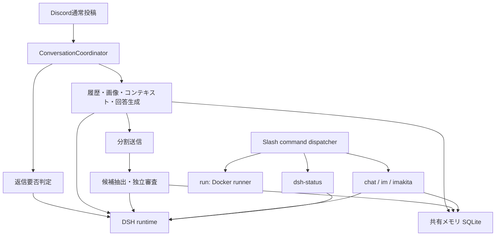
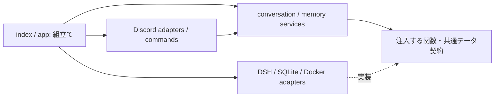

# chat-with-poe コードレビューとリファクタリング計画

レビュー日: 2026-10-21。対象は `/home/wgkz/chat-with-poe` の現在の作業ツリー。リンク先のRust製Botは対象に含めない。

この文書はレビューと実装計画であり、以下の不具合を修正したことを意味しない。本番コードは変更していない。既存の未コミット変更を含め、エントリポイント、全8ツールモジュール、全4テストファイル、DSH設定、セットアップ処理、機能説明文書、依存関係定義を確認した。秘密情報・実際の会話・本番メモリは閲覧していない。

追記（IM高速化対応後）: このレビュー本文の行番号・行数・20件というテスト数はレビュー時点のスナップショット。後続変更でIMは専用Vertexクライアント・独立した並列数/期限・message dispatcherへ分離された。R1/R2は通常のDSH経路に残る課題であり、IMについては後続の専用経路と追加テストを参照する。

## 1. 現在の構造

アプリケーションとセットアップのJavaScriptは計1,458行。そのうち `index.js` が747行を占め、外部サービスとの接続、機能の振り分け、回答の組み立てを同時に担っている。

| 場所 | 現在の責務・依存 | 機能追加時の影響 |
|---|---|---|
| `index.js:20–28,201–210,729–747` | 環境設定、SQLite生成、Discord接続、終了処理 | importだけでDB作成・ログインへ進み、個別機能を隔離して検証しにくい |
| `index.js:49–162,212–245,593–697` | 画像取得、Discordレコード化、履歴選択、プロンプト構築、メモリ参照、回答生成 | 添付形式やモデルを増やすと、Discord・AI・メモリの変更が同じ場所へ集まる |
| `index.js:165–199,247–267,280–399` | 5コマンドの定義・登録・実行・公開範囲 | 定義、許可名一覧、分岐、公開範囲を別々に編集する必要がある |
| `index.js:401–499,699–727` | 履歴要約、自動介入判定、イベント受付、typing | 通常投稿とコマンドの入力・プロンプト・エラー処理が別々に実装されている |
| `index.js:501–590` | チャンネル参照ツールの定義 | `createChannelTools` に呼び出し元がなく、現在の実行経路から外れている |
| `tools/conversation-coordinator.js` | 同一チャンネル・同一投稿者の集約、再生成1回制限、保留・抑止 | コールバック注入済みで分割の土台になる。Discordオブジェクトの持ち回りと終了契約は整理が必要 |
| `tools/dsh-runtime.js` | DSH子プロセス、起動共有、セッション直列化、再起動、アイドル終了 | モジュール全体の状態と環境変数に依存し、偽のDSHへ差し替えにくい |
| `tools/memory-service.js` | 候補抽出、根拠照合、独立審査、バックグラウンドキュー | 審査ロジックとプロンプト、JSON解析、保存条件が一体化している |
| `tools/memory-store.js` | SQLite接続、トランザクション、期限、件数上限、関連度計算 | 保存順序・スキーマ進化・検索方針の変更が同じクラスへ集まる |
| `tools/delivery.js` | フェンス解析、UTF-16単位の分割、Discord送信、公開範囲 | 純粋な整形処理とネットワーク送信を分けると双方を検証しやすい |
| `tools/run-code.js` | 20言語の定義、Docker引数、キュー、一時ファイル、実行・後始末 | 言語追加と実行基盤・制限の変更が結合。実行中ジョブを終了処理から追跡できない |
| `tools/errors.js` | 固定カテゴリ化、安全なログ・利用者向け文言 | 安全な出力境界として維持できる |
| `tools/setup-dsh-profile.js`, `dsh/poe.patch.yml` | DSHプロファイル準備、互換パッチ、共通persona、ツール無効化 | 運用スクリプトと実行時ポリシー。業務処理の分割と別に扱う |

現在の主な処理経路は次のとおり。



`/chat` は送信後にメモリ抽出へ進む。`/im` と `/imakita` は現在メモリを参照するが、抽出は起動しない。通常投稿は回答後に周辺発言を含めて抽出する。この違いは、統合する際に誤って変えない。

## 2. レビュー所見

P1は運用を止めたり、制限を機能させなくする問題。P2は特定入力や処理順で誤動作する問題。構造上の課題は、再現した不具合と区別する。

### R1 / P1: タイムアウトと終了処理が、実際の生成の完了・停止を管理できていない

根拠: `index.js:472–484,733–745`、`tools/dsh-runtime.js:53,135–182`、`tools/conversation-coordinator.js:70–72`、`tools/memory-service.js:74–77`。

自動介入判定のタイムアウトは `Promise.race` により待ち手を返すだけで、`runInDsh` の処理を止めない。待ち手が8秒で返信不要と判定しても、DSH側の処理と `activeRuns` は残り得る。現在のSDK実装では `requestTimeoutMs` はJSON-RPC要求に適用され、`HarnessSession.run()` の `subscription.next()` によるidle待ち全体には期限がない。

終了処理は `conversationCoordinator.close()`、`memoryService.close()` を先に無期限で待つため、DSHを終了させる処理まで到達できない場合がある。`closeDsh()` 内の15秒待ちは、この外側の待ち時間を制限しない。`/run` はその終了待ちの対象にもなっていない。

確認: 一時プローブでは分類期限を5msへ短縮した。偽のモデル処理を保留したまま分類の期限を過ぎると、分類はfalseを返すがモデル処理は保留のまま。保留中の生成に対するcoordinatorのcloseも、観察時間25msの後に未完了だった。無期限になる条件は上記のawaitとSDKのソースから確認したもので、実際のAPIを無期限で待ったわけではない。

方針: LLM呼び出しの受付から生成完了までの期限、キュー中の取消、実行中処理の停止、アプリ全体の終了予算を同じ管理境界で扱う。SDKに中断APIがない状態で `AbortSignal` を引数へ足すだけでは解決しない。harnessを停止・再作成する際の同時実行への影響も明示する。

### R2 / P1: 入口ごとの上限が、LLM全体の流量制御になっていない

根拠: `index.js:280–399,699–727`、`tools/dsh-runtime.js:124–161`。

通常投稿には64会話、メモリ抽出には保留8件の上限がある一方、Slash commandからのLLM呼び出しに同じ上限は適用されない。DSHのキューも同一session IDだけの直列化で、アプリ側は毎回新しいIDを作る。分類、回答、要約、疎通確認、メモリ審査を横断した同時実行数・保留数・期限の管理がない。

タイムアウト後の処理が残るR1と組み合わさると、会話数の上限だけではモデル処理数を抑えられない。これは各入口とキュー実装を追った所見であり、本番への負荷試験は行っていない。

方針: 全LLM処理が通る受付を設け、用途別の優先度と全体の上限を管理する。メモリ抽出は回答より低い優先度にし、混雑時は明示的にスキップする。上限値は設定へ集約し、実測から調整する。

### R3 / P2: 古い根拠を再処理すると、新しいメモリを巻き戻せる

根拠: `index.js:693,703–705`、`tools/memory-service.js:22–23,56–70`、`tools/memory-store.js:32–36`。

周辺発言は回答ごとに再び抽出対象になるが、抽出用のレコードから発言時刻が落ちる。同じsubject/topicの保存は無条件のUPDATEで、根拠の新旧や既存レコードの版を確認しない。

確認: 同じ投稿者・同じtopicについて、新しい「Rustが好み」を審査・保存した後、古い「Pythonが好み」を再抽出して審査に通すと、保存内容がPythonへ戻った。モデル応答はダミーとし、実際のMemoryServiceと一時SQLiteで確認した。

方針: 根拠の作成・編集時刻、根拠の版、審査が参照した保存版を保持する。SQLの条件付き更新で古い根拠の上書きを防ぎ、審査中に対象が更新されていたら再審査または更新拒否とする。発言の編集も扱えるよう、message IDの大小だけには依存しない。

### R4 / P2: 有効な閉じフェンスで2,000文字を超える送信片を作る

根拠: `tools/delivery.js:34–39`。

閉じフェンスを追加する前にflushすると、currentへ再開フェンスが入る。その後、再開フェンスと閉じフェンスの合計長を再確認していない。

確認: 「バッククォート3本＋js、改行、x、改行、バッククォート2,000本」を分割すると、各片の長さは `[12, 2006]`。これは有効なMarkdownの閉じ方だが、Discordの2,000文字上限を超える。

方針: 行全体が単独で収まるかではなく、再開・終了マーカーを含む最終片の長さを毎回検証する。純粋な分割処理を送信処理から分離し、長い閉じマーカーを回帰例に追加する。

### R5 / P2: 自動介入判定が範囲外のconfidenceを受理する

根拠: `index.js:485–491`。

現在はNumberへの変換と有限性だけを検証するため、0〜1以外の値や数値文字列も通る。確認では `{"needs_reply":true,"confidence":999}` で返信対象となった。失敗時に返信を控えるという説明と合わない。

方針: `confidence` がnumber型で0以上1以下、`needs_reply` がbooleanであることを検証する。欠損、不正JSON、範囲外は返信不要とする。プロンプトと出力検証を返信判定サービスへまとめる。

### R6 / P2: 画像形式の受付方針が二重化し、同じ要求内で矛盾する

根拠: `index.js:30–36,49–132,149–150`、`dsh/poe.patch.yml:21`。

画像ローダーはHEIC/HEIFを対応形式として取得するが、回答生成直前のDSHチェックはその形式を拒否する。GIFはDSH側のチェックにある一方、画像ローダーでは拒否される。静的に確認できる不一致で、現在のモデルが各形式を受理するかのAPI試験は行っていない。

方針: モデル能力とBotが提供する形式を一か所で定義し、対応しない形式はダウンロード前に拒否する。変換を提供する場合は独立した処理として明示し、画像の個別・合計サイズ制限を維持する。

## 3. 分割を妨げる構造上の課題

- **生成と接続の副作用がimportに含まれる。** `index.js` が即時にDBを生成し、ログインする。`dsh-runtime.js` もdotenv読込と起動時ログ、モジュール単位の状態を持つ。importだけで外部作用が起きない構成へ変える必要がある。
- **Discord固有型と用途のルールが混在する。** コンテキスト、メモリ根拠、プロンプトに生のMessageの構造を直接使うため、別の入力経路や新しいコマンドの追加が重くなる。
- **JSONの形と公開範囲の契約が散在する。** 通常投稿とSlashのレコードは同じschema名だが、実際の必須項目が異なる。メモリ観測用にはさらに別のレコードを手で作っている。Discordの非公開応答とDSHのセッション再利用抑止がどちらも `ephemeral` と呼ばれる点も整理する。
- **未使用コードを移すと実装済み機能に見える。** `createChannelTools`、その専用ヘルパー、coordinatorの `has()` は現在使われていない。チャンネル横断参照を将来有効にする場合、Botの権限だけを見る既存関数をそのまま公開してよいとは限らない。現行の共有メモリ方針とは別に、機能のアクセス方針を定義する必要がある。
- **検証境界に偏りがある。** 既存20件は分割済みモジュールの一部を検証するが、コマンド振り分け、DSHのライフサイクル、画像取得、コンテキスト組み立て、Docker実行境界のテストはない。通過数だけでは全体の安全性は判断できない。
- **スキーマと互換処理の更新方針が必要。** SQLiteは現在CREATE TABLE IF NOT EXISTSだけで、将来の列追加・既存DB移行を管理する仕組みがない。セットアップのnode_modules書換えも依存バージョンに結び付いた互換処理として管理する。

## 4. 目指す分割

新しいフレームワークやDIコンテナは導入せず、既存のES Modules、関数、コンストラクタ引数による注入を使う。小さいクラスを機械的に分解せず、外部I/O、機能単位、独立した方針の境界で分割する。

```text
index.js                          # 設定読込、createApplication、startのみ
src/
  app.js                          # 依存の組立て、start/stop、全ジョブの終了管理
  config.js                       # 検証済み設定。dotenv読込は入口のみ
  contracts.js                    # JSDocによる共通入力・出力の型
  discord/
    client.js                     # Client生成、接続、イベント接続・解除
    command-registry.js           # 定義・scope・公開範囲・実行関数の一覧
    commands/
      chat.js
      run.js
      im.js
      imakita.js
      dsh-status.js
    messages.js                   # Message / Interaction → 共通レコード
    history.js                    # Discord履歴取得・ページング・参照取得
    delivery.js                   # 送信、公開範囲、部分送信失敗の扱い
    typing.js                     # typingの開始と確実な解放
  conversation/
    coordinator.js                # 集約・抑止・再生成回数
    service.js                    # コンテキスト取得→回答→送信→メモリ観測
    context.js                    # 履歴選択・画像と発言の対応付け
    reply-policy.js               # 返信要否の入力と厳密な出力検証
  ai/
    dsh-runtime.js                # SDK・子プロセス・受付制限・期限・再起動
    prompts.js                    # 用途別プロンプト。外部I/Oなし
    capabilities.js               # 利用モデルと提供可能な入力形式
  attachments/
    images.js                     # URL・形式・サイズ検証、画像取得
  memory/
    service.js                    # 抽出→根拠検証→独立審査
    sqlite-store.js                # 保存、期限、版管理、移行、関連メモリ取得
  execution/
    docker-runner.js               # Docker起動・制限・ジョブ追跡・解放
    languages.js                   # 言語と固定イメージ・固定実行コマンド
  formatting/
    discord-text.js                # UTF-16分割・フェンス解析の純粋処理
  errors.js                       # 安全なカテゴリ・公開文言・ログ
scripts/
  setup-dsh-profile.js
dsh/poe.patch.yml                  # 共通persona・ツール無効化は継続
tests/                            # 各機能の単体・境界・アプリ結合検証
```

これは到達形の案で、全ディレクトリを最初に空で作る計画ではない。既存のMemoryServiceとMemoryStoreはまずそのままの粒度で移す。検索方式などが増えた時点で方針を切り出す。

依存の向きを次に固定する。



serviceからDiscord Client、SQLite接続、SDK、子プロセスを直接生成しない。コマンド実装からDSHのプロファイルやDocker引数へ触れない。`formatting` とプロンプト構築はデータを返すだけにする。

## 5. 共通契約

実装時には次をJSDocで定義し、境界で検証する。汎用的な巨大Contextオブジェクトを全層へ渡さない。

| 契約 | 主な内容 | 保つ境界 |
|---|---|---|
| `MessageRecord` | 発言ID、投稿者ID、チャンネル、本文、作成・編集時刻、参照先、添付メタデータ | 元の発言本文をプロンプト都合で書き換えない。引用への回答指示は別フィールドにする |
| `ConversationContext` | 直近発言、今回のバッチ、参照先、画像と発言の対応 | バッチと履歴を重複させず、時系列と出典を保持する |
| `AiRequest` | purpose、content blocks、期限、signal、sessionPolicy | 用途はanswer/classify/convert/summarize/memory-extract/memory-review/status。fresh sessionと非公開応答を別概念にする |
| `Reply` | 本文、public/private、返信先、mention方針 | 初回応答から全追送まで同じ公開範囲を適用する |
| `MemoryCandidate` | subject、topic、根拠本文・ID・時刻・版、審査時の保存版 | 本文の一致だけでなく、根拠の新旧と更新競合も確認する |
| `ExecutionRequest/Result` | 言語ID、ソース、制限、signal／終了状態・stdout・stderr | 入力からイメージ、マウント、任意コマンドを指定できない |

コマンド登録は `{ definition, scope, visibility, execute }` を唯一の一覧とし、登録payload、dispatch、公開範囲をそこから導出する。新コマンドを作る際に、既存の名前許可リストと巨大if文へ追記する必要をなくす。

メモリ参照・観測の有無も用途ごとに明示する。現在の挙動から変更する場合は、単なるファイル移動と別の変更として扱う。

## 6. 実施順序と受け入れ条件

各工程はレビューできるPR単位とする。移動だけのコミットと挙動修正のコミットを分け、依存先とテスト結果を追跡できるようにする。

| 順序 | 作業 | 完了を確認する条件 |
|---|---|---|
| PR 1: 構成と入口 | `createApplication(config, dependencies)` と `loadConfig` を作り、DB・Discord・DSHの生成を明示化。既存モジュールの移動は必要最小限 | importだけではDB、ログイン、子プロセス、タイマー、コマンド登録が発生しない。偽の依存だけでappを生成・停止でき、2インスタンスの状態が混ざらない |
| PR 2: 実行管理 | runtimeをインスタンス化し、R1/R2を修正。全LLM入口の上限、優先度、全体期限、取消、終了予算を管理。Dockerジョブも追跡する | 保留と実行中を区別して取消できる。分類待ちが切れた後に管理外の処理が残らない。停止中に新規処理を受理せず、指定予算内にDSH・Dockerを終了・回収できる。失敗しても残りの資源解放を続ける |
| PR 3: 入力・コンテキスト | MessageRecord、履歴gateway、画像ローダー、context builderを切り出す。能力定義を統一しR6を修正 | 同じ入力fixtureから同じ時系列・画像対応が得られる。通常投稿とSlashで同じ形式検証が働く。画像上限、参照先、添付のみ、バッチ上限を維持する |
| PR 4: コマンドと回答用途 | 5コマンドを個別化し、登録・dispatch・公開範囲をregistryへ集約。reply-policyと用途別promptを抽出しR5を修正 | 新コマンドの追加が専用ファイルとregistry登録で完結する。不明コマンドがchatへ落ちない。不正な判定JSONは返信不要。各用途のメモリ参照・観測方針を検証できる |
| PR 5: 配信 | 純粋な整形とDiscord送信を分離しR4を修正。途中まで送れた場合の扱いも定義 | どの断片も2,000単位以内でサロゲートペアを割らない。長い閉じフェンスにも対応する。非公開の全追送とmention抑止を維持し、送信済みの断片を不用意に再送しない |
| PR 6: メモリ更新 | R3を修正。根拠の版・保存版を追加し、明示的なスキーマ移行を導入。候補検証と審査入力を整理 | 古い発言・遅れて届く審査・編集済み発言・重複観測で新情報を巻き戻さない。既存DBの移行試験が通り、審査拒否・失敗は保存しない。30日期限と共有方針を維持する |
| PR 7: 残りの境界と整理 | Docker runnerと言語定義、セットアップスクリプトを所定の場所へ移動。未使用コードを削除し、構造と運用手順を更新 | 言語追加で実行制限やDiscord routerを変更しなくて済む。偽のDockerで安全フラグ・queue・timeout・rmを検証。未使用のチャンネル参照を誤って公開しない。新規セットアップと再実行が通る |

PR 5はPR 3以降なら先行してよい。R4は単独の小さな修正にもできる。重要なのはR1/R2を後回しにして、ファイル名だけを先に整える状態にしないこと。

### 実行管理を実装する際の注意

現SDKにwire-level cancelがないため、実際の中断を必要とする場合はharnessを監督する境界まで停止を伝える。初期実装で共有harnessを再起動するなら、巻き添えになる実行を明示的に失敗させ、結果の混入や無制限の再送を防ぐ。用途別プロセス分離やworker poolは、必要な並行数・メモリ使用量を計測してから選ぶ。

アプリの停止は、全入口の受付停止→期限内のdrain→残った処理の中断→外部資源の回収→DBと接続のclose、という一つの終了予算で実施する。待ち手だけを返すPromise.raceを「中断完了」として扱わない。

### DB移行を実装する際の注意

`PRAGMA user_version` 等でスキーマの版を管理し、必要な列を明示したSQLを使う。根拠の時刻・編集版が不明な旧レコードを、新しい根拠より優先させない。共有・審査・期限の意味は既存データでも保つ。移行前のバックアップと復元手順を用意し、列追加を含むPRはコードだけを戻す操作で安全に巻き戻せると仮定しない。

## 7. 検証方針

現在の20件を基準に、以下を機能の境界で追加する。製品コードをコピーしたテストではなく、入力と観測可能な結果を検証する。時間とSDK、HTTP、Dockerのプロセス実行を注入し、実APIを使わずに異常系を再現する。

- アプリ: importに副作用なし、各イベントのdispatch、二重start/stop、起動途中の失敗、停止中の新規要求、全資源の解放。
- DSH: 同時起動の共有、生成受付後のidle欠落、キュー超過、取消、再起動失敗、古いharnessの遅延結果、終了期限。
- コマンド: 5コマンドの定義とhandlerの対応、scope、公開範囲、不明コマンド、返答途中の失敗。
- コンテキスト: 元の本文を保持した引用、複数投稿、重複した参照、画像の対応、履歴取得失敗、最大件数。
- 画像: 対応外形式の事前拒否、CDN制限、リダイレクト、時間・サイズ上限、読み取り途中の失敗、合計上限。
- 配信: 2,000単位境界、長い閉じフェンス、フェンス長の違い、絵文字、空文字、非公開追送、部分送信失敗。
- メモリ: 古い根拠による上書き、審査中の更新競合、根拠の編集、期限の境界、審査拒否、重複観測、既存DB移行。
- Docker: 固定イメージ・固定コマンド、安全フラグ、入力上限、同時実行・queue、異常終了・取消・一時ファイルとcontainerの解放。

現在のレビューで行った確認:

| 確認 | 結果・範囲 |
|---|---|
| Node 22.19.0で既存 `npm test` | 20件成功 |
| 追加の一時プローブ | R3/R4/R5、分類タイムアウト後の保留、生成中の終了待ちを再現。実装への修正・テスト追加は未実施 |
| SDKソース確認 | JSON-RPCの期限とsessionのidle待ちが別であることを確認 |
| 外部サービス・本番データ | Discord、Gemini、Docker実行、本番DB、認証情報は使っていない |

レビュー時のシェルはNode 20のため、テストには導入済みのNode 22を指定した。

```bash
PATH=/home/wgkz/deepseek-harness/node-runtime/node_modules/node/bin:$PATH npm test -- --test-reporter=dot
```

## 8. 機能追加が容易になったことの判定

- 要約形式を追加する: 専用commandとpromptを追加し、既存の履歴・AI・private配信を利用できる。
- 新しい添付形式を追加する: capabilitiesと添付処理、対応する検証を変更し、既存コマンドhandlerを書き換えずに済む。
- 実行言語を追加する: 言語カタログと検証を変更し、Dockerの安全設定やDiscord routerを触らずに済む。
- 別モデルを追加する: AI adapterと能力定義を変更し、会話集約、メモリの審査条件、Discord送信を変更しない。
- メモリ検索を改善する: repository境界内で検索方針を差し替え、保存・期限・独立審査の契約を維持できる。

メモリの全利用者間共有、1.2秒/4秒の集約、再生成1回、既存コマンド名と公開範囲、Dockerの隔離設定、安全なエラーログは移行の基準とする。変更が必要なら、不具合修正または機能変更として別途明示する。
